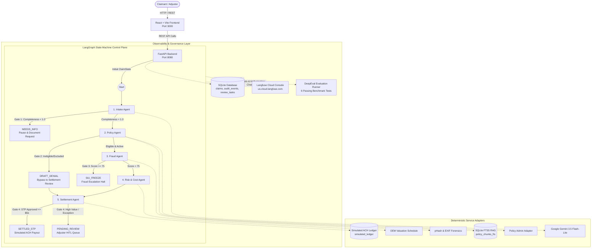

# AegisFlow: Autonomous Multi-Agent Insurance Claims Processing Platform

> **An enterprise-grade, decision-support motor claims orchestration workflow powered by LangGraph, SQLite FTS5 RAG, Human-in-the-Loop adjudication, DeepEval LLM governance, and Langfuse OpenTelemetry observability.**

[](https://fastapi.tiangolo.com)
[](https://langchain-ai.github.io/langgraph/)
[](https://react.dev)
[](https://confident-ai.com)
[](https://opentelemetry.io/)
[](https://prometheus.io/)
[](https://langfuse.com)
[](https://python.org)

---

## Table of Contents
1. [Executive Summary](#executive-summary)
2. [High-Level Architecture](#high-level-architecture)
3. [LangGraph State Machine & Control Plane](#langgraph-state-machine--control-plane)
4. [Detailed Agent Node Specifications](#detailed-agent-node-specifications)
   - [Agent 1: Intake & FNOL Extraction](#agent-1-intake--fnol-extraction-agent)
   - [Agent 2: Policy Coverage Evaluation (RAG)](#agent-2-policy-coverage-evaluation-agent-rag)
   - [Agent 3: Fraud & Forensics Detection](#agent-3-fraud--forensics-detection-agent)
   - [Agent 4: Damage & Cost Assessment](#agent-4-damage--cost-assessment-agent)
   - [Agent 5: Settlement & Decision Orchestrator](#agent-5-settlement--decision-orchestrator)
5. [Canonical State Schema (`ClaimState`)](#canonical-state-schema-claimstate)
6. [Deterministic Arithmetic & Financial Safety](#deterministic-arithmetic--financial-safety)
7. [Database Architecture & RAG Retrieval](#database-architecture--rag-retrieval)
8. [Observability & OpenTelemetry (Langfuse)](#observability--opentelemetry-langfuse)
9. [AI Governance & Benchmarking (DeepEval)](#ai-governance--benchmarking-deepeval)
10. [Pre-Packaged Demonstration Scenarios](#pre-packaged-demonstration-scenarios)
11. [REST API Specification](#rest-api-specification)
12. [Local Setup & Verification](#local-setup--verification)

---

## Executive Summary

The **AegisFlow** platform automates First Notice of Loss (FNOL) intake, policy contract verification, perceptual image fraud detection, OEM component repair cost estimation, and financial settlement determination. 

### Core Design Philosophy
- **No MCP (Model Context Protocol) Dependency**: Operates entirely with native, deterministic in-process Python service adapters for Policy Administration Systems (PAS), Image Forensics, OEM Cost Schedules, and Simulated ACH Ledgers. This eliminates inter-process latency and networking instability.
- **Deterministic Math Guardrails**: Financial calculations (deductibles, depreciation, payout bounds) are executed via strict Python mathematical logic (`max(0, approved - deductible - depreciation)`), never by stochastic LLM token generation.
- **Human-in-the-Loop (HITL) by Default for Adverse Actions**: Per regulatory compliance guidelines, AI agents never issue unilateral, binding claim denials. Ineligible or high-fraud claims generate structured decision briefs routed to human adjusters or the Special Investigation Unit (SIU).
- **SQLite FTS5 Keyword RAG**: Indexed contract clause search with exact page and section citations with zero external vector database infrastructure.
- **Enterprise Observability & Governance**: Instrumented with **Langfuse** for OpenTelemetry traces and **DeepEval** for continuous unit-testing of RAG faithfulness, answer relevancy, and extraction fidelity.

---

## High-Level Architecture

The platform follows a modern decoupled architecture: a high-performance **FastAPI** backend orchestrating a compiled **LangGraph** finite-state machine, connected to a reactive **React + Vite** dashboard with real-time telemetry.



---

## LangGraph State Machine & Control Plane

The adjudication graph is compiled as a `langgraph.graph.StateGraph` using a single, canonical `ClaimState` contract. Each node is a pure agent function that reads state, executes deterministic business rules and optional LLM extractions, appends an immutable audit event, and transitions state to the next stage.

```
       [ Claim Submission ]
                │
                ▼
      ┌──────────────────┐
      │   Intake Agent   │
      └─────────┬────────┘
                │
         [ Gate 1 Exit ]
        /               \
       / < 1.0           \ == 1.0
      ▼                   ▼
[ NEEDS_INFO ]    ┌──────────────────┐
(Pipeline Pauses) │   Policy Agent   │
                  └─────────┬────────┘
                            │
                     [ Gate 2 Exit ]
                    /               \
        Not Covered/                 \ Active & Covered
                  ▼                   ▼
         ┌──────────────────┐ ┌──────────────────┐
         │ (Bypass to       │ │   Fraud Agent    │
         │  Settlement)     │ └─────────┬────────┘
         └────────┬─────────┘           │
                  │              [ Gate 3 Exit ]
                  │             /               \
                  │  Score >= 75/                \ Score < 75
                  │            ▼                  ▼
                  │     [ SIU_FREEZE ]    ┌──────────────────┐
                  │     (Pipeline Pauses) │ Risk/Cost Agent  │
                  │                       └─────────┬────────┘
                  │                                 │
                  └────────────────────────┐        │
                                           ▼        ▼
                                ┌──────────────────────┐
                                │   Settlement Agent   │
                                └──────────┬───────────┘
                                           │
                                    [ Gate 4 Exit ]
                                   /               \
                STP & Payout <= $5k/                \ > $5k or Exception
                                  ▼                  ▼
                           [ SETTLED_STP ]    [ PENDING_REVIEW ]
                           (Instant ACH)      (Human Adjuster Queue)
```

---

## Detailed Agent Node Specifications

### Agent 1: Intake & FNOL Extraction Agent
- **Purpose**: Validates incoming First Notice of Loss (FNOL) payloads, calculates submission completeness, and enriches unstructured accident narratives with structured JSON entities.
- **Required Fields**: `policy_no`, `loss_date`, `claimed_amt`, `vin`, and at least one itemized document (`repair_estimate` or `repair_invoice`).
- **Entity Extraction**: Calls Google Gemini (`gemini-3.5-flash-lite`) using JSON schema enforcement to parse:
  - `loss_type`: Collision, comprehensive, rollover, side-impact.
  - `estimated_damage_severity`: Minor, Moderate, Severe, Total Loss.
  - `primary_impact_area`: Front bumper, rear fender, passenger quarter-panel, etc.
- **Gate 1 Logic**:
  - If any mandatory field is missing: `completeness < 1.0`, status set to `NEEDS_INFO`, graph **halts execution**, and a customer document request is generated.
  - If all fields present: `completeness = 1.0`, status set to `INTAKE_PASSED`, routes to `policy`.

### Agent 2: Policy Coverage Evaluation Agent (RAG)
- **Purpose**: Verifies that the insurance policy was active on the date of loss, performs Full-Text Search (FTS5) retrieval over policy contracts, and drafts a coverage rationale citing exact section titles and page numbers.
- **Policy Admin System (PAS) Verification**: Checks policy effective dates (`effective_date <= loss_date <= expiration_date`) and premium payment standing.
- **SQLite FTS5 RAG Pipeline**:
  - Queries `policy_chunks_fts` matching keywords (`collision`, `deductible`, `exclusions`, `speed contest`, `racing`).
  - Fetches top matching clauses with BM25 ranking.
- **Coverage Brief Generation**: Prompts Google Gemini with the retrieved policy clauses and claim details to draft an objective coverage brief citing policy sections.
- **Gate 2 Logic**:
  - If loss is excluded (e.g. Section 8.3 track racing) or policy lapsed: `eligible = False`, status set to `COVERAGE_EXCEPTION`, graph **bypasses fraud/risk** and routes directly to `settle` to prepare a draft denial for adjuster review.
  - If covered: `eligible = True`, deductible extracted ($500 standard), routes to `fraud`.

### Agent 3: Fraud & Forensics Detection Agent
- **Purpose**: Detects duplicate claims, digital image tampering, and chronological timeline anomalies across photos and submission metadata.
- **Multi-Vector Fraud Heuristics**:
  1. **Perceptual Hash (`pHash`) Collision Check**: Computes image perceptual hashes and matches against settled claims database. Hamming distance $= 0$ flags duplicate recycled accident photos (+50 fraud score).
  2. **EXIF Timestamp Cross-Examination**: Compares photo EXIF metadata against reported accident timestamp. Photos captured $>30$ days prior to the reported accident indicate pre-existing damage (+40 fraud score).
  3. **GPS Coordinate Plausibility**: Verifies photo geolocation matches reported loss location (+15 fraud score if mismatched).
- **Composite Fraud Score (0 - 100)**:
  $$\text{Score} = \min(100, \sum \text{Anomaly Weights})$$
- **Gate 3 Logic**:
  - If `fraud_score >= 75`: `siu_escalate = True`, status set to `PENDING_REVIEW` with task type `SIU_FRAUD`, graph **freezes immediately**, blocking automated payout.
  - If `fraud_score < 75`: Passes to `risk`.

### Agent 4: Damage & Cost Assessment Agent
- **Purpose**: Standardizes repair cost estimates against OEM labor and parts benchmarks and applies age-based vehicle depreciation.
- **OEM Component Pricing Benchmark**:
  - Benchmarks claimed estimate against manufacturer labor rates ($85/hr standard vs $110/hr structural) and OEM replacement schedules.
  - Generates `approved_estimate` (flags inflated shop estimates).
- **Depreciation Calculation**:
  $$\text{Depreciation} = \text{Approved Parts Cost} \times (\text{Vehicle Age} \times 0.035)$$
  *(Capped at 30% maximum depreciation).*
- **Risk Tiering**:
  - Assigns `LOW_RISK`, `MEDIUM_RISK`, or `HIGH_RISK` based on vehicle valuation and severity.

### Agent 5: Settlement & Decision Orchestrator
- **Purpose**: Performs deterministic financial arithmetic, checks straight-through processing (STP) limits, records simulated ACH payment transactions, or assigns human review tasks.
- **Deterministic Math Matrix**:
  $$\text{Net Payout} = \max(0.00, \; \text{Approved Estimate} - \text{Deductible} - \text{Depreciation})$$
- **Gate 4 Logic**:
  - **Fast-Track STP (`SETTLED_STP`)**: If `eligible == True`, `fraud_score < 25`, and `net_payout <= $5,000.00`, automated disbursement triggers immediately. Generates simulated ACH reference (`ACH-xxxx`) and writes to `simulated_ledger`.
  - **Adjuster Approval Queue (`PENDING_REVIEW`)**: If `net_payout > $5,000.00`, high complexity, or coverage exception, generates a review task (`TSK-ADJ-xxxx`) for adjuster sign-off.
  - **Human Confirmation of Denial**: Denials are queued as `TSK-COV-xxxx` with full policy citations.

---

## Canonical State Schema (`ClaimState`)

The state machine shares a single canonical TypedDict contract across all nodes:

```python
class ClaimState(TypedDict, total=False):
    claim_id: str                      # Unique identifier (e.g. CLM-DEMO-001)
    claim_type: str                    # motor, property, liability
    intake_data: Dict[str, Any]        # Policy no, loss date, claimed amt, VIN, photos, docs
    completeness: float                # 0.0 to 1.0 intake completeness
    missing_fields: List[str]          # Missing required keys
    
    policy_validation: Dict[str, Any]  # active, eligible, deductible, citations, rationale
    fraud_report: Dict[str, Any]       # fraud_score (0-100), siu_escalate, flags, matches
    risk_assessment: Dict[str, Any]    # approved_estimate, depreciation, risk_tier
    settlement_decision: Dict[str, Any]# net_payout, status (STP/ADJUSTER), txn_ref
    
    current_status: str                # INTAKE_PASSED, SETTLED_STP, PENDING_REVIEW, etc.
    route_reason: str                  # Explainable decision rationale
    audit_events: List[Dict[str, Any]] # Chronological audit log with evidence payloads
    errors: List[str]                  # Pipeline execution errors
    trace_id: Optional[str]            # Langfuse OpenTelemetry trace ID
    trace_url: Optional[str]           # Direct Langfuse cloud UI link
```

---

## Deterministic Arithmetic & Financial Safety

All financial values are strictly calculated in Python code with zero floating point drift and zero generative randomness:

```
┌────────────────────────────────────────────────────────┐
│        DETERMINISTIC SETTLEMENT ARITHMETIC MATRIX      │
├────────────────────────────────────────────────────────┤
│  Claimed Repair Estimate:                $3,200.00     │
│  OEM Benchmark Approved Estimate:        $2,950.00     │
│  Less Standard Deductible (Section 4.5): - $500.00     │
│  Less Age Depreciation (3.5% / yr):      - $210.00     │
│ ────────────────────────────────────────────────────── │
│  Net Approved Settlement Payout:         $2,240.00     │
│  STP Limit Authority:                    $5,000.00     │
│  Execution Result:                       FAST-TRACK    │
│  Simulated ACH Ledger Reference:         ACH-99201-01  │
└────────────────────────────────────────────────────────┘
```

Financial safety invariants are guaranteed through automated tests in `backend/tests/test_math.py`:
1. **Non-negativity Invariant**: `Net Payout >= 0.00` always, even if Deductible + Depreciation exceeds Approved Estimate.
2. **Authority Guard**: Payouts exceeding `$5,000.00` are strictly blocked from automated disbursement.
3. **Idempotent Ledger Guard**: Re-running an approved claim cannot duplicate payments due to `UNIQUE(claim_id)` constraint in SQLite.

---

## Database Architecture & RAG Retrieval

SQLite operates in **WAL (Write-Ahead Logging)** mode with strict foreign key constraints.

### Entity-Relationship Diagram

```
┌─────────────────────────────────────────────────────────────────┐
│                             claims                              │
├────────────────────────────────┬────────────────────────────────┤
│ claim_id (PK)                  │ TEXT                           │
│ status                         │ TEXT (IN_PROGRESS, SETTLED_STP)│
│ claim_type                     │ TEXT                           │
│ created_at / updated_at        │ TEXT (ISO-8601 UTC)            │
│ state_json                     │ TEXT (Full ClaimState snapshot)│
│ trace_id                       │ TEXT (Langfuse Trace ID)       │
│ trace_url                      │ TEXT (Direct Langfuse URL)     │
└───────────────┬───────────────────────────────┬─────────────────┘
                │ 1                             │ 1
                │                               │
                │ *                             │ *
┌───────────────▼────────────────┐   ┌──────────▼─────────────────┐
│          audit_events          │   │        review_tasks        │
├─────────────────┬──────────────┤   ├──────────────┬─────────────┤
│ event_id (PK)   │ INTEGER AUTO │   │ task_id (PK) │ TEXT        │
│ claim_id (FK)   │ TEXT         │   │ claim_id (FK)│ TEXT        │
│ stage           │ TEXT         │   │ task_type    │ TEXT        │
│ event_type      │ TEXT         │   │ priority     │ TEXT        │
│ route_reason    │ TEXT         │   │ status       │ TEXT        │
│ evidence_json   │ TEXT         │   │ details_json │ TEXT        │
│ created_at      │ TEXT         │   │ created_at   │ TEXT        │
└─────────────────┴──────────────┘   └──────────────┴─────────────┘
                │ 1
                │ 
                │ 0..1
┌───────────────▼────────────────┐   ┌────────────────────────────┐
│        simulated_ledger        │   │     policy_chunks_fts      │
├─────────────────┬──────────────┤   ├──────────────┬─────────────┤
│ txn_id (PK)     │ TEXT         │   │ chunk_id     │ UNINDEXED   │
│ claim_id (FK, U)│ TEXT         │   │ policy_type  │ UNINDEXED   │
│ amount          │ REAL         │   │ section_title│ TEXT (FTS5) │
│ recipient       │ TEXT         │   │ chunk_text   │ TEXT (FTS5) │
│ status          │ TEXT         │   │ page_number  │ UNINDEXED   │
│ created_at      │ TEXT         │   └──────────────┴─────────────┘
└─────────────────┴──────────────┘
```

### SQLite FTS5 Contract Retrieval Pipeline
1. Policy contract documents are chunked into discrete clauses (Section 4.2 Collision, Section 4.5 Deductibles, Section 8.3 Exclusions).
2. Inserted into virtual table `policy_chunks_fts USING fts5(chunk_id, policy_type, section_title, chunk_text, page_number)`.
3. Policy Agent queries clauses via BM25 matching:
   ```sql
   SELECT chunk_id, section_title, chunk_text, page_number, rank
   FROM policy_chunks_fts
   WHERE policy_chunks_fts MATCH ?
   ORDER BY rank
   LIMIT 5;
   ```
4. Citations are returned with exact section names and page numbers for auditability.

---

## Observability & Distributed Tracing (OpenTelemetry & Langfuse)

The platform implements an enterprise-grade, native **OpenTelemetry (OTel)** telemetry engine coupled with **Langfuse** for complete execution visibility into the multi-agent graph, HTTP requests, and LLM generations:

```
[ W3C Distributed Trace: insurance.claim.adjudication (32-char Hex ID) ]
 │
 ├── [ HTTP Server Span: POST /api/claims/submit ] ────> Injects X-Trace-Id header
 │
 ├── [ Root Claim Span: insurance.claim.adjudication ]
 │    ├── Attribute: claim.id = "CLM-DEMO-001"
 │    ├── Attribute: claim.loss_type = "rear_collision"
 │    ├── Attribute: claim.claimed_amt = 3200.00
 │    │
 │    ├── [ Child Span: agent.intake ] ─────── (Duration: 1,842 ms, Status: OK)
 │    │    ├── Attribute: claim.completeness = 1.00
 │    │    └── Attribute: claim.status = "INTAKE_PASSED"
 │    │
 │    ├── [ Child Span: agent.policy ] ─────── (Duration: 3,110 ms, Status: OK)
 │    │    ├── Attribute: policy.eligible = true
 │    │    ├── Attribute: policy.deductible = 500.00
 │    │    └── Attribute: policy.citations_count = 4
 │    │
 │    ├── [ Child Span: agent.fraud ] ──────── (Duration: 8.4 ms, Status: OK)
 │    │    ├── Attribute: fraud.score = 12.00
 │    │    ├── Attribute: fraud.siu_escalate = false
 │    │    └── Attribute: fraud.flags_count = 0
 │    │
 │    ├── [ Child Span: agent.risk ] ───────── (Duration: 5.2 ms, Status: OK)
 │    │    ├── Attribute: risk.tier = "LOW"
 │    │    ├── Attribute: risk.approved_estimate = 2950.00
 │    │    └── Attribute: risk.depreciation = 210.00
 │    │
 │    └── [ Child Span: agent.settle ] ─────── (Duration: 11.5 ms, Status: OK)
 │         ├── Attribute: settlement.status = "SIMULATED_STP"
 │         ├── Attribute: settlement.payout = 2240.00
 │         └── Attribute: settlement.requires_human_approval = false
 │
 └── [ Langfuse LLM Generation Tracing & Session Scores ]
      ├── intake_completeness: 1.00
      ├── policy_eligibility: 1.00
      ├── fraud_risk_score: 12.00
      ├── proposed_payout: $2,240.00
      └── straight_through_processing: 1.00
```

### 1. Dual Exporter Architecture
- **In-Memory Ring-Buffer Exporter**: Retains the last 250 finished spans in a thread-safe ring-buffer. Allows zero-dependency diagnostic inspection via `/api/telemetry/spans` and frontend telemetry visualization without requiring external infrastructure.
- **Standard OTLP HTTP/Proto Exporter**: Automatically activates when `OTEL_EXPORTER_OTLP_ENDPOINT` is configured. Transmits traces directly to any OTLP-compliant collector (e.g. Jaeger, Grafana Tempo, SigNoz, Datadog, or Honeycomb).
- **Console Exporter**: Toggled via `OTEL_TRACES_CONSOLE=true` for local terminal stream debugging.

### 2. Standard Semantic Conventions & Attribute Catalogue
| Scope | Attribute Key | Type | Description |
|---|---|---|---|
| **Root Claim** | `insurance.claim.id` | `string` | Unique claim identifier (e.g. `CLM-DEMO-001`) |
| **Root Claim** | `claim.loss_type` | `string` | Peril category (collision, rear_collision, theft) |
| **Root Claim** | `claim.claimed_amt` | `float` | Original amount claimed by policyholder |
| **Root Claim** | `claim.status` | `string` | Terminal adjudication status (`SETTLED_STP`, `PENDING_REVIEW`) |
| **Agent Intake** | `claim.completeness` | `float` | FNOL completeness ratio between 0.0 and 1.0 |
| **Agent Intake** | `claim.missing_fields_count` | `int` | Count of missing mandatory attachments or data fields |
| **Agent Policy** | `policy.eligible` | `bool` | Whether loss is covered under active contract |
| **Agent Policy** | `policy.deductible` | `float` | Contractual deductible applied in USD |
| **Agent Policy** | `policy.citations_count` | `int` | Number of verified FTS5 clauses cited |
| **Agent Fraud** | `fraud.score` | `float` | Composite fraud score (0 - 100) |
| **Agent Fraud** | `fraud.siu_escalate` | `bool` | Whether claim tripped the SIU freeze threshold ($\ge 75$) |
| **Agent Risk** | `risk.tier` | `string` | Risk categorization (`LOW`, `MEDIUM`, `HIGH`) |
| **Agent Risk** | `risk.approved_estimate`| `float` | OEM labor and parts benchmarked amount |
| **Agent Settle** | `settlement.payout` | `float` | Net payout calculated via deterministic formula |
| **Agent Settle** | `settlement.status` | `string` | Settlement stage (`SIMULATED_STP`, `DRAFT_DENIAL`, etc.) |

### 3. OpenTelemetry Metric Instruments
| Instrument Name | Type | Unit | Description |
|---|---|---|---|
| `claims.submitted.total` | Counter | `1` | Total count of claims ingested into the platform |
| `claims.processed.total` | Counter | `1` | Total count of claims adjudicated by multi-agent graph |
| `claims.siu_referrals.total` | Counter | `1` | Count of claims escalated to Special Investigations Unit |
| `claims.policy_exceptions.total` | Counter | `1` | Count of coverage denials or contract exclusions drafted |
| `claims.settlement.payout` | Histogram | `USD` | Distribution of approved claim payout amounts |
| `claims.fraud.score` | Histogram | `1` | Distribution of composite fraud scores across all claims |
| `agent.execution.duration_ms` | Histogram | `ms` | Granular per-agent execution latency in milliseconds |

### 4. Telemetry REST Endpoints
- `GET /api/telemetry/status`: Returns current OpenTelemetry runtime status, service name, metric totals, and recent spans.
- `GET /api/telemetry/spans?claim_id={id}&limit=50`: Retrieves filtered OpenTelemetry spans captured by the in-memory buffer.
- `POST /api/telemetry/reset`: Clears in-memory span buffer for clean testing sessions.

### 5. Prometheus Metrics Exposition (`/metrics`)
For teams operating Prometheus servers or Grafana Agents, AegisFlow exposes the official Prometheus text exposition format on both `/metrics` and `/api/metrics`:
- **`GET /metrics`**: Standard root Prometheus scrape target (`Content-Type: text/plain; charset=utf-8`).
- **`GET /api/metrics`**: API-mounted scrape target.

Prometheus Metric Catalog:
```prometheus
# HELP insurance_claims_submitted_total Total count of submitted insurance claims
# TYPE insurance_claims_submitted_total counter
insurance_claims_submitted_total{claim_type="motor",loss_type="rear_collision"} 5

# HELP insurance_claims_processed_total Total count of processed insurance claims
# TYPE insurance_claims_processed_total counter
insurance_claims_processed_total{is_stp="true",loss_type="rear_collision",status="SETTLED_STP"} 5

# HELP insurance_claims_settlement_payout_dollars Approved claim settlement payout amounts in USD
# TYPE insurance_claims_settlement_payout_dollars histogram
insurance_claims_settlement_payout_dollars_bucket{le="1000.0"} 0.0
insurance_claims_settlement_payout_dollars_bucket{le="5000.0"} 5.0
insurance_claims_settlement_payout_dollars_sum 11200.0
insurance_claims_settlement_payout_dollars_count 5.0

# HELP insurance_agent_execution_duration_seconds Execution latency of individual autonomous agents in seconds
# TYPE insurance_agent_execution_duration_seconds histogram
insurance_agent_execution_duration_seconds_bucket{agent_name="policy",le="5.0"} 5.0
insurance_agent_execution_duration_seconds_bucket{agent_name="fraud",le="0.05"} 5.0
```

---

## AI Governance & Benchmarking (DeepEval)

Production agent outputs are continuously validated against unit-testing benchmarks using **DeepEval** and Google Gemini:

| Test ID | Evaluation Metric | Evaluated Node | Benchmark Criteria | Score Threshold | Achieved |
|---|---|---|---|---|---|
| `EVAL-001` | **FaithfulnessMetric** | Policy Agent | Verifies coverage determination brief is strictly grounded in retrieved FTS5 policy clauses with zero hallucinations. | $\ge 0.70$ | **1.00 (100%)** |
| `EVAL-002` | **AnswerRelevancyMetric** | Policy Agent | Measures whether coverage explanation directly answers the claimant's specific loss incident. | $\ge 0.70$ | **1.00 (100%)** |
| `EVAL-003` | **GEval (Denial Compliance)** | Settlement Node | Ensures drafted denials for racing exclusions maintain an objective, non-adversarial tone and cite Section 8.3. | $\ge 0.70$ | **1.00 (100%)** |
| `EVAL-004` | **GEval (Entity Extraction)** | Intake Agent | Validates JSON extraction accuracy (loss type, damage severity, impacted parts) from unstructured FNOL narratives. | $\ge 0.70$ | **1.00 (100%)** |
| `EVAL-005` | **GEval (Regulatory Notice)** | Policy / Intake | Evaluates formal statutory language and non-binding disclaimer compliance on lapsed policy notices. | $\ge 0.70$ | **1.00 (100%)** |
| `EVAL-006` | **GEval (Payout Transparency)**| Settlement Node | Validates that payout explanations transparently detail approved estimates, deductibles, depreciation, and net totals. | $\ge 0.70$ | **1.00 (100%)** |

---

## Pre-Packaged Demonstration Scenarios

The system includes 5 pre-packaged synthetic scenarios demonstrating distinct control paths through the multi-agent graph:

```
┌────────────────────────────────────────────────────────────────────────────────────────┐
│                        SYNTHETIC SCENARIO EXECUTION MATRIX                             │
├────┬────────────────────────────┬──────────────┬───────────────┬────────────────────────┤
│ #  │ Scenario Name              │ Claim ID     │ Exit Gate     │ Final Adjudication     │
├────┼────────────────────────────┼──────────────┼───────────────┼────────────────────────┤
│ 01 │ Routine Rear Collision     │ CLM-DEMO-001 │ Gate 4 (STP)  │ SETTLED_STP ($2,240)   │
│ 02 │ Incomplete Submission      │ CLM-DEMO-002 │ Gate 1 (Stop) │ NEEDS_INFO (Halted)    │
│ 03 │ Amateur Track Racing Loss  │ CLM-DEMO-003 │ Gate 2 (Byp)  │ PENDING_REVIEW (Denial)│
│ 04 │ Recycled Photo / EXIF Pred │ CLM-DEMO-004 │ Gate 3 (Stop) │ PENDING_REVIEW (SIU)   │
│ 05 │ High-Value Audi RS6 Damage │ CLM-DEMO-005 │ Gate 4 (HITL) │ PENDING_REVIEW (Limit) │
└────┴────────────────────────────┴──────────────┴───────────────┴────────────────────────┘
```

1. **Scenario 1: Routine Rear Collision (`CLM-DEMO-001`)**
   - Clean EXIF, no prior pHash matches (fraud score 12), valid collision coverage.
   - Net payout: $2,950 approved - $500 deductible - $210 depreciation = **$2,240.00**.
   - Qualifies for automated Straight-Through Processing (`SETTLED_STP`). Instant simulated ACH disbursement.
2. **Scenario 2: Incomplete Submission (`CLM-DEMO-002`)**
   - Missing vehicle VIN and repair invoice.
   - Halts at Gate 1 with `NEEDS_INFO` (completeness 0.50). Queues document request.
3. **Scenario 3: Excluded Activity (`CLM-DEMO-003`)**
   - Damage occurred during amateur racetrack speed contest event.
   - Bypasses fraud and risk stages at Gate 2. Drafts coverage denial citing Section 8.3 (General Exclusions) and refers to human adjuster.
4. **Scenario 4: Potential Fraud (`CLM-DEMO-004`)**
   - Photo perceptual hash matches settled claim `CLM-2024-1102` and EXIF timestamp predates reported accident by 2 months.
   - Fraud score reaches 85 ($\ge 75$). Freezes at Gate 3 for SIU review (`TSK-SIU-xxxx`).
5. **Scenario 5: High-Value Luxury Collision (`CLM-DEMO-005`)**
   - 2024 Audi RS6 Avant with $18,500 claimed, $14,000 net approved payout.
   - Passes all checks but exceeds $5,000.00 STP authority limit. Routed to Senior Claims Adjuster for sign-off.

---

## REST API Specification

| Method | Endpoint | Description |
|---|---|---|
| `POST` | `/api/claims/submit` | Submits a claim payload and triggers the LangGraph pipeline. Returns full `ClaimState`. |
| `GET` | `/api/claims` | Lists all submitted claims with current state, trace ID, and trace URL. |
| `GET` | `/api/claims/{claim_id}` | Retrieves full claim state, trace URL, and pending review tasks. |
| `GET` | `/api/claims/{claim_id}/audit` | Retrieves chronological audit event trail for a claim. |
| `GET` | `/api/reviews` | Lists pending Human-in-the-Loop review tasks (Adjuster or SIU). |
| `POST` | `/api/reviews/{task_id}/decision` | Records adjuster decision (`APPROVED`, `REJECTED`, `REQUEST_INFO`), notes, and payout. |
| `GET` | `/api/scenarios` | Lists the 5 pre-packaged synthetic demo scenarios. |
| `POST` | `/api/scenarios/run/{scenario_key}` | Triggers 1-click execution of a synthetic demo scenario. |
| `GET` | `/api/observability/status` | Returns Langfuse connectivity status and cloud base URL. |
| `GET` | `/api/evals/report` | Returns latest DeepEval LLM evaluation report and metric pass rates. |
| `POST` | `/api/evals/run` | Triggers an on-demand DeepEval benchmark run. |
| `POST` | `/api/database/reset` | Resets demo database, claims, ledger, and review tasks to clean state. |

---

## Local Setup & Verification

### Prerequisites
- Python 3.11+
- Node.js 18+ and npm
- Google Gemini API Key ([AI Studio](https://aistudio.google.com/))
- Langfuse API Keys ([Langfuse Cloud](https://cloud.langfuse.com))

### 1. Environment Configuration
Copy `sample.env` to `.env` and configure your credentials:
```bash
copy sample.env .env    # Windows
# cp sample.env .env    # macOS / Linux
```

Fill in your API keys in `.env`:
```env
GEMINI_API_KEY=your_gemini_api_key_here
LLM_PROVIDER=gemini

LANGFUSE_SECRET_KEY=sk-lf-your-secret-key-here
LANGFUSE_PUBLIC_KEY=pk-lf-your-public-key-here
LANGFUSE_BASE_URL=https://us.cloud.langfuse.com
LANGFUSE_HOST=https://us.cloud.langfuse.com
```

### 2. Backend Execution
```bash
# Activate virtual environment
.venv\Scripts\activate   # Windows
# source .venv/bin/activate  # macOS / Linux

# Install dependencies
pip install -r backend/requirements.txt

# Start FastAPI server on port 8080
python -m uvicorn backend.app.main:app --host 127.0.0.1 --port 8080 --reload
```
Interactive Swagger API documentation: [http://127.0.0.1:8080/docs](http://127.0.0.1:8080/docs)

### 3. Frontend Execution
```bash
cd frontend
npm install
npm run dev -- --host 127.0.0.1 --port 3000
```
Open the enterprise claims dashboard: [http://127.0.0.1:3000/](http://127.0.0.1:3000/)

### 4. Running Verification Test Suites
```bash
# Run unit tests (math invariants, FTS5 RAG clause search, scenario routing, Langfuse observability)
python -m pytest backend/tests/test_math.py backend/tests/test_fts5.py backend/tests/test_scenarios.py backend/tests/test_observability.py -v

# Run DeepEval LLM benchmark suite (100% pass rate)
python -m pytest backend/tests/test_deepeval.py -v

# Run standalone DeepEval report generator
python -m backend.evals.runner

# Validate production frontend build
cd frontend && npm run build
```

---

## License & Attribution

Designed and developed as an internal proof-of-concept for autonomous multi-agent insurance claims adjudication with verifiable compliance, zero-drift arithmetic, and continuous observability.
