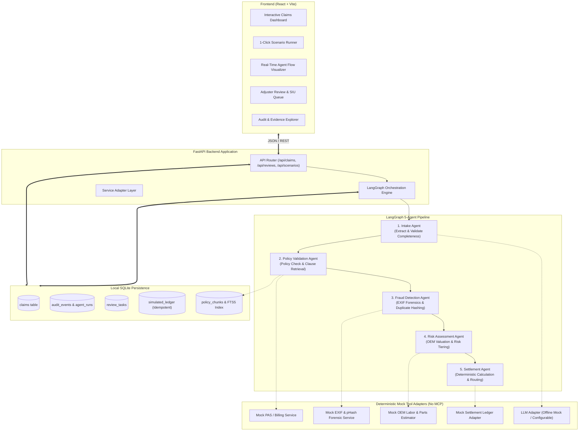
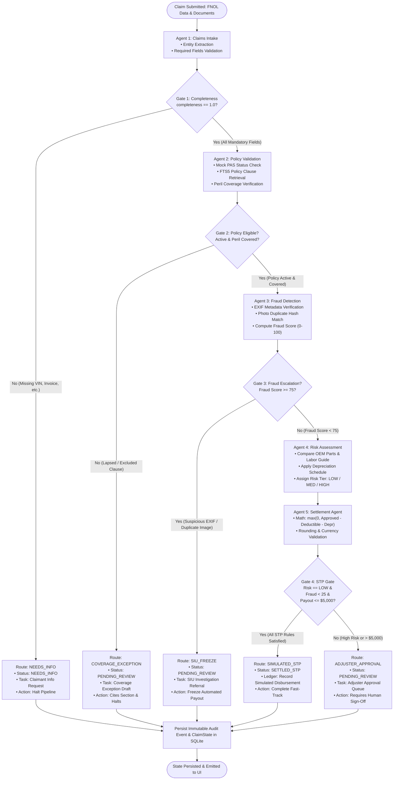

# System Architecture: Autonomous Multi-Agent Insurance Claims PoC

## 1. High-Level Component Architecture

The diagram below illustrates the structural topology of the system, comprising the React UI, FastAPI Backend, LangGraph Orchestration Layer, SQLite Persistence + FTS5 Retrieval, and Mock External Adapters (strictly without MCP).

---

## 2. End-to-End Claim Execution & Exception Flow

The diagram below details the exact state transitions, conditional gating logic, and exception exit ramps for the five demo scenarios.

---

## 3. Human-in-the-Loop (HITL) Workflow

When a claim lands in `PENDING_REVIEW` or `NEEDS_INFO`:
1. A record is inserted into `review_tasks` with `priority` and `task_type`.
2. The React frontend presents the task in the **Human Review Queue** with complete context (extracted claim fields, cited policy clauses, fraud triggers, and proposed numbers).
3. The adjuster or investigator clicks **Approve**, **Reject**, or **Request Information**.
4. The backend API (`POST /api/reviews/{id}/decision`) updates the task, adjusts the settlement amount if requested, updates `claims`, logs an audit entry, and records the simulated disbursement if approved.
