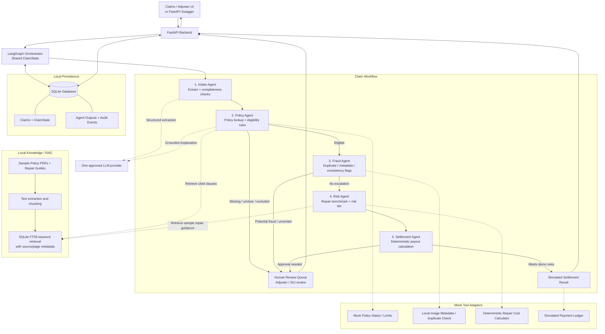
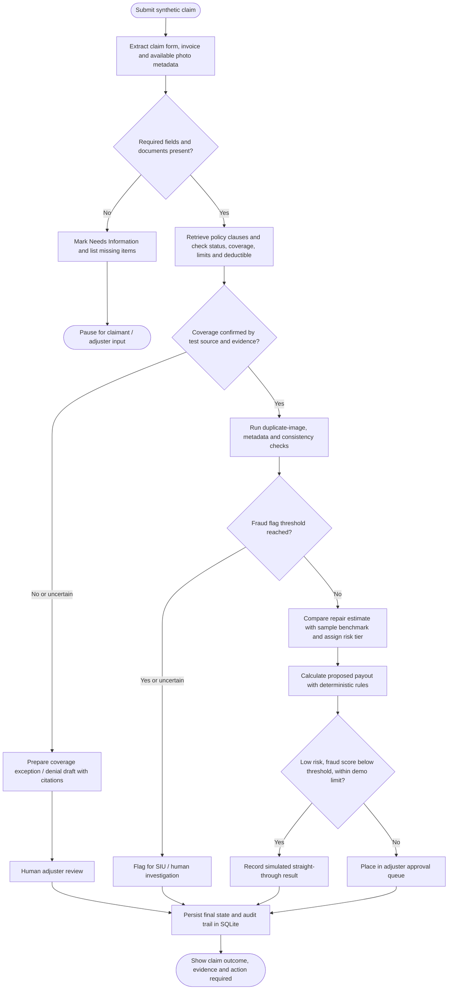

# Autonomous Multi-Agent Insurance Claims Processing
## Internal Proof of Concept — 4–5 Day Scope

## 1. Idea

Build a small, end-to-end insurance claims workflow that demonstrates how AI-assisted document extraction, policy retrieval, basic fraud checks, risk assessment, and settlement calculation can work together under a controlled workflow.

The PoC will focus on **motor insurance claims** and synthetic/sample data. It will demonstrate decision support and routing—not production-grade autonomous claim adjudication.

### Business problem
Claims processing often requires staff to inspect claim forms, invoices, policy wording, photos, and cost estimates across several manual steps. The PoC tests whether a structured workflow can reduce repetitive review and give adjusters a traceable decision brief.

### PoC objective
For a submitted test claim, the application should:
1. Extract claim details and identify missing information.
2. Retrieve relevant policy text and check policy eligibility against known test data.
3. Flag potential fraud indicators for investigation.
4. Estimate the eligible repair amount using explicit rules and sample benchmarks.
5. Calculate a proposed settlement and route it to simulated straight-through processing or human review.
6. Record each step, evidence source, routing reason, and outcome in SQLite.

## 2. Architecture



### Design choices
- **LangGraph** controls the stateful workflow and conditional routing.
- The five agents are separate workflow nodes/modules; they do not need to be five independent LLM-powered services.
- Use the LLM where it helps most: document extraction and explaining retrieved policy evidence. Use ordinary Python rules for validation, thresholds, and financial arithmetic.
- **SQLite** stores claims, workflow results, review status, and audit records.
- Use **SQLite FTS5** for the first version of local policy/repair-document retrieval. It offers keyword-based RAG without requiring PostgreSQL or a separate vector database. Do not describe it as semantic vector search.
- External carrier APIs, forensic services, email, and payment services are mocked or implemented as local functions.
- MCP is intentionally excluded from the critical path. Add it only if the stakeholder specifically wants an MCP integration demonstration and time permits.

## 3. End-to-end claim flow



### Routing rules for the demo
Use configurable **demo thresholds**, not universal insurance rules:
- Missing mandatory information → stop and request/record missing information.
- Policy lapse, exclusion, or uncertain policy evidence → prepare a cited exception/denial draft for human approval; do not issue an automatic final denial.
- Fraud score **≥ 75** or significant inconsistent evidence → route to human/SIU review.
- Simulated straight-through path only when risk is `LOW`, fraud score is **< 25**, and proposed payout is within a configurable demo authority limit (for example, **$5,000**). Otherwise require adjuster approval.
- No real payment, external communication, or irreversible action is executed.

## 4. Shared ClaimState contract

Keep a validated state object that every node reads and updates. A minimal version can contain:

```json
{
  "claim_id": "CLM-DEMO-001",
  "claim_type": "motor",
  "intake_data": {},
  "completeness": 1.0,
  "policy_validation": {
    "active": true,
    "eligible": true,
    "deductible": 500,
    "evidence": []
  },
  "fraud_report": {
    "fraud_score": 10,
    "flags": [],
    "requires_review": false
  },
  "risk_assessment": {
    "approved_estimate": 2950,
    "depreciation": 210,
    "risk_tier": "LOW"
  },
  "settlement_decision": {
    "proposed_payout": 2240,
    "status": "SIMULATED",
    "requires_human_approval": false
  },
  "current_status": "COMPLETED",
  "audit_event_ids": []
}
```

This is illustrative test data, not a real claim. Calculate the proposed payout in code using a documented rule such as:

`proposed_payout = max(0, approved_estimate - deductible - depreciation)`

Validate the inputs and currency/rounding rules before calculating.

## 5. SQLite persistence

Minimum tables:
- `claims`: claim ID, timestamps, current status, current ClaimState JSON.
- `agent_runs`: claim ID, node/agent, input/output JSON, status, duration, error information.
- `audit_events`: claim ID, event type, route/reason, evidence references, timestamp, human action if any.
- `policy_chunks`: source document, page/section, text chunk; index the searchable text with SQLite FTS5.
- `review_tasks`: claim ID, reason, priority, review status, reviewer note.

Keep uploaded sample documents in a local directory and store their paths and source metadata in SQLite. Do not store client-sensitive material unless explicitly approved.

## 6. PoC demo scenarios

Implement at least these five synthetic scenarios:
1. **Routine claim:** complete documents, active policy, no fraud flags, low risk → simulated settlement result.
2. **Missing information:** missing VIN or repair invoice → `NEEDS_INFO` and pause.
3. **Inactive / excluded policy:** retrieve relevant source text and prepare a coverage exception draft for a human.
4. **Potential fraud:** duplicate image or inconsistent metadata → human/SIU review; not an automated fraud finding.
5. **High estimate / high risk:** proposed payout exceeds demo authority or risk is not low → adjuster approval queue.

## 7. Acceptance criteria

The PoC is complete when:
- A claim can be submitted and processed end-to-end through the API or a simple UI.
- Each workflow node writes schema-valid structured output and routes as expected for the demo scenarios.
- Policy-related explanations show the supporting source document and page/section where available.
- Settlement arithmetic is deterministic and covered by unit tests.
- Missing-information, coverage-exception, fraud-escalation, and manual-approval paths work.
- Claim state, stage outputs, errors, route reasons, and final outcome can be inspected in SQLite.
- A short demo can show one routine claim and at least two exception cases.

Report observed metrics rather than claiming targets have been achieved before testing. With a tiny synthetic dataset, results demonstrate functional behavior, not production accuracy.

## 8. Four-to-five-day execution outline

- **Day 1:** Confirm the motor-claim scope and test scenarios; create the FastAPI project, SQLite schema, `ClaimState`, and mock claims.
- **Day 2:** Implement intake extraction, document ingestion, SQLite FTS5 policy retrieval, and policy validation.
- **Day 3:** Implement fraud indicators, risk rules, settlement calculation, and conditional LangGraph routes.
- **Day 4:** Add review queue/API or a minimal UI, audit views, and end-to-end test scenarios.
- **Day 5 (buffer/demo):** Fix integration issues, run acceptance tests, prepare architecture/demo notes, and show the workflow to stakeholders.

If only four days are available, prioritize API/Swagger or a very small UI, the five core scenarios, SQLite persistence, policy citations, and the audit trail. Defer MCP, live enterprise APIs, advanced semantic retrieval, production authentication/authorization, real payment execution, and training a fraud model.

## 9. Stakeholder message

**Proposed PoC:** An AI-assisted motor insurance claims workflow using LangGraph, a shared validated claim state, local policy retrieval, rule-based risk and settlement calculations, and SQLite audit persistence. The system will demonstrate claim intake, evidence-backed policy checks, fraud/risk flagging, and settlement recommendations with conditional routing to human adjusters. External services will be mocked, and all payments and denial decisions will remain simulated or subject to human approval. The goal is to validate workflow feasibility and measure performance on agreed synthetic test cases within four to five days—not to claim production readiness.
